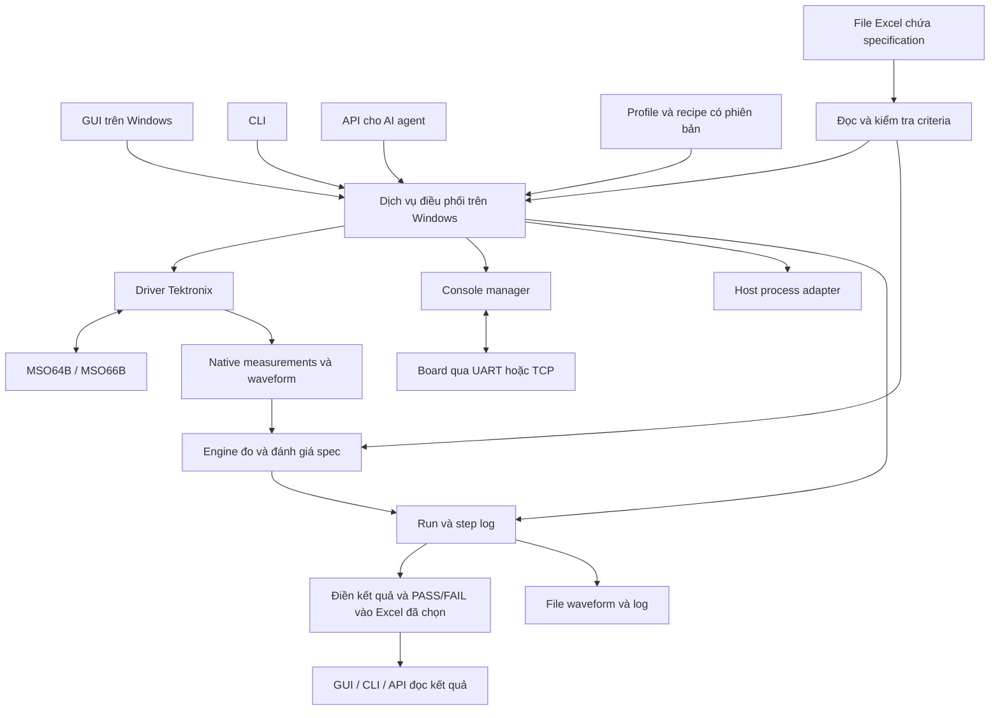
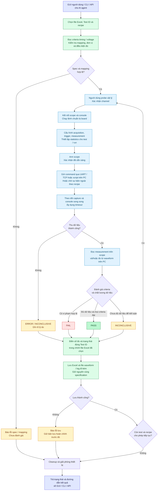

# Kế hoạch tool validation low-speed interface

Phiên bản kế hoạch: 0.7 — cập nhật 28/10/2026. Đã triển khai demo 0.1 cho LAN SCPI → native measurement → Excel; thiết kế đầy đủ bên dưới vẫn là lộ trình mở rộng. Chưa xác nhận với máy đo vật lý.

Demo hiện tại: nhập IP/port sau, kết nối MSO6B, đọc danh sách measurement, gán Test ID trong Excel với MEASx, đọc CURRENTACQ sau Stop hoặc Single, đánh giá giới hạn, điền số đo/PASS/FAIL và lưu backup. GUI và CLI dùng chung workflow. Chạy bằng `Start_Demo.cmd`; cách dùng và giới hạn trong `README.md`. Các kiểm thử dùng scope giả lập giao thức chỉ nằm trong bộ test, không có chế độ mô phỏng trong GUI/CLI. USB/VISA, console board, API server, raw waveform và protocol analysis chưa nằm trong demo 0.1.

Mục tiêu là ứng dụng Windows điều khiển Tektronix MSO64B/MSO66B, gửi lệnh tới board qua console, đọc specification timing/voltage từ file Excel của người dùng, điền kết quả đo và đánh dấu PASS/FAIL vào đúng dòng trong workbook đó. Cùng chức năng được cung cấp qua GUI, CLI và API cho AI agent. Người dùng tự kết nối probe vật lý.

**Phạm vi đã thống nhất**

| Hạng mục | Phạm vi |
|---|---|
| Oscilloscope | MSO64B hoặc MSO66B; nhận diện model, firmware, option và khả năng thực tế khi kết nối |
| Scope control | Cấu hình channel/acquisition/trigger; run, stop, single, force; chờ trạng thái với timeout |
| Native measurement | Liệt kê, đọc, thêm/cấu hình phép đo trên scope khi được hỗ trợ; lưu cả điều kiện đo |
| Waveform | Thu dữ liệu đồng bộ, lưu/mở lại, đo offline và đánh dấu bằng chứng |
| Interfaces | GPIO/PWM/reset/interrupt, SPI, I²C, UART; kiến trúc cho phép bổ sung interface khác |
| Board console | UART và TCP console riêng; TCP framing/handshake chưa chốt; adapter SSH/Telnet là mở rộng nếu cần |
| Host command | Chạy executable/script trên Windows khi recipe cần công cụ console hiện có; phân biệt rõ host process và board command |
| Spec | Đọc timing/voltage criteria từ Excel, theo linh kiện, chân, hướng truyền, điều kiện nguồn/tải và phiên bản datasheet |
| Người vận hành | GUI trên Windows để cấu hình, điều khiển thiết bị, chạy phép đo và xem kết quả |
| AI agent | CLI trả JSON và API có schema, job/status/result/cancel; không cần điều khiển chuột |
| Lưu kết quả | Điền số đo và PASS/FAIL vào file Excel (.xlsx) chứa specification; waveform và log lưu thành file bằng chứng đi kèm |

**Kiến trúc đề xuất**

Một process giữ các kết nối vật lý. GUI/CLI/API đều gọi dịch vụ này; không mở session điều khiển độc lập. Mỗi scope và console có khóa sở hữu theo job/session. Đọc trạng thái vẫn được phép trong lúc chạy; thay đổi cấu hình được tuần tự hóa. Phân tích offline có thể chạy song song với acquisition nếu đủ tài nguyên.

Python là lựa chọn đề xuất cho driver và engine; PyVISA/tm_devices cho scope, adapter UART/TCP cho console, REST API với OpenAPI. Công nghệ GUI được chọn ở giai đoạn đặc tả giao diện; cần chạy được trên Windows và dùng cùng API. FastAPI có hỗ trợ OpenAPI/JSON Schema trong [tài liệu chính thức](https://fastapi.tiangolo.com/features/).

**Flowchart vận hành theo kế hoạch mới**

Sơ đồ mô tả luồng chạy test trên bench. Scope dùng MSO64B/MSO66B; console nối board qua UART hoặc TCP riêng. Hai nguồn đo được chọn theo recipe và giữ rõ nguồn kết quả.

Nhánh lỗi setup/kết nối/arm/đo được xử lý tương tự ERROR: ghi lý do vào đúng dòng nếu mapping hợp lệ và thực hiện cleanup. Lỗi mapping phải được báo trên GUI/CLI/API; không ghi đoán vào Excel. Không tự chạy lại command khi không biết command trước đã thực thi hay chưa. Nhánh tiếp tục chỉ áp dụng khi recipe và trạng thái thiết bị cho phép; chuyển probe phải chờ xác nhận thực tế.

Chế độ offline dùng cùng các bước đọc criteria và đánh giá/ghi Excel: mở capture đã lưu → phân tích waveform trên PC → đánh giá criteria → điền và lưu kết quả. Không cần bước cấu hình scope hoặc gửi command board.

**Điều khiển và lấy measurement trên scope**

Thiết kế hai cách vận hành: đọc setup/measurement hiện có của người dùng, hoặc áp dụng cấu hình từ recipe. Snapshot cấu hình thực tế trước và sau thay đổi. Mặc định không factory-reset; việc thay cấu hình và statistics phải là bước rõ ràng của recipe.

Trigger catalog dự kiến gồm edge, pulse width, timeout, runt, logic, setup/hold và serial bus, tùy firmware/option. Scope driver phải báo supported/unsupported/unknown; không giả định mọi command trong tài liệu đều khả dụng trên máy đang kết nối. Nguồn tra cứu: [Tektronix trigger commands, gồm MSO6B](https://tm-devices.readthedocs.io/stable/reference/tm_devices/commands/gen_7n037o_lpdmso/trigger/).

Kết quả có hai nguồn: `scope_native` và `waveform_analysis`. Cả hai cùng lưu type, source channel, reference levels, gating, đơn vị và phương pháp thống kê. Chỉ so sánh khi định nghĩa tương thích; không tự gộp hai bộ số liệu.

Phân biệt kết quả acquisition hiện tại và thống kê tích lũy nhiều acquisition. API Tek có các nhóm kết quả tương ứng và population; cần chọn đúng phạm vi và kiểm tra dữ liệu hợp lệ. Tham khảo [measurement commands](https://tm-devices.readthedocs.io/stable/reference/tm_devices/commands/gen_7n037o_lpdmso/measurement/).

Thiết kế reset/baseline statistics theo run; driver xác minh cách thực hiện trên firmware thực tế. Lưu `capture_id` hoặc `acquisition_set_id` đúng phạm vi. Min/max tích lũy không được gắn với riêng waveform cuối. Nếu không có raw evidence tương ứng, báo rõ không xác định được waveform của trường hợp xấu nhất.

**Console và thực thi lệnh**

UART profile khai báo COM port, baud rate, data bits, parity, stop bits, flow control và cách xử lý DTR/RTS phù hợp board. TCP profile khai báo host/port, encoding, delimiter hoặc framing, prompt, handshake nếu có và timeout. Không giả định mỗi lần TCP read tương ứng một phản hồi hoàn chỉnh.

Console manager đọc liên tục và xử lý output từng phần, echo, prompt và log tự phát. Một lệnh gồm text/bytes, completion condition và deadline. Kết quả phân biệt sent, completed, matched expectation, timeout và unknown outcome. UART/TCP không mặc định có exit code; exit code chỉ dùng khi transport hoặc giao thức cung cấp.

GUI terminal và AI dùng cùng session, với transcript timestamp và command ID. Nếu COM port đang do terminal ngoài giữ, cần chuyển quyền hoặc adapter thích hợp. Chạy script/executable trên host dùng executable + argument list + working directory + timeout, kèm stdout/stderr/exit code; target host hay board luôn tường minh. Không dùng UI scraping làm phương án mặc định.

Khi timeout sau khi gửi lệnh, không tự gửi lại lệnh có tác động nếu chưa biết lần trước đã chạy hay chưa. Cancellation của job có thể dừng acquisition và host process do tool tạo; việc hủy lệnh trên board phụ thuộc protocol và phải được báo đúng trạng thái.

**Chuỗi chạy một recipe**

1. Chọn file Excel và các dòng test; kiểm tra criteria/đơn vị, mapping Test ID với phép đo, profile, kết nối và probe/channel; chụp lại spec áp dụng, tạo run ID và giữ khóa thiết bị.
2. Kết nối console, bắt đầu ghi log và chạy các lệnh chuẩn bị theo recipe.
3. Snapshot scope; cấu hình channel/acquisition/trigger/measurement; thiết lập phạm vi statistics mới.
4. Arm scope và xác nhận đã sẵn sàng theo trạng thái thiết bị.
5. Gửi lệnh board tạo tình huống cần đo. Recipe cũng có thể chờ sự kiện ngoài mà không gửi lệnh.
6. Theo dõi capture và console song song, với timeout riêng; không đợi lệnh chạy dài kết thúc rồi mới kiểm tra scope.
7. Cố định acquisition, chờ measurement hợp lệ, tải native results/waveform và metadata của cùng lần thu.
8. Kiểm tra chất lượng, tính phép đo trên PC khi yêu cầu, đối chiếu criteria đã đọc từ Excel, điền số đo và PASS/FAIL/trạng thái chưa đánh giá vào đúng dòng test, lưu file bằng chứng đi kèm.
9. Thực hiện bước cleanup đã khai báo; cập nhật trạng thái run trong workbook, xác nhận lưu thành công và giải phóng session; tạo Excel tổng hợp khi được yêu cầu. Nếu lưu lỗi, báo trạng thái lỗi và vẫn thực hiện cleanup.

Force trigger và auto trigger phải được ghi rõ; không tự coi là sự kiện mục tiêu. Thời điểm host gửi command chỉ dùng truy vết; đo delay điện cần cạnh tham chiếu trong capture. Không trộn các capture khác thời điểm để đo setup/hold. Khi đo chính đường UART đang dùng làm console, phải phân biệt echo/log nền với traffic mục tiêu.

**Catalog phép đo và profile**

| Nhóm | Các phép đo dự kiến |
|---|---|
| Voltage chung | HIGH/LOW, min/max/Vpp, overshoot/undershoot, noise trong cửa sổ ổn định, logic margin |
| Timing chung | Rise/fall/slew, period/frequency, duty, pulse width, glitch, delay/skew, thống kê biến thiên thời gian |
| GPIO/PWM/reset/interrupt | Phép đo chung và quan hệ thời gian với tín hiệu tham chiếu |
| SPI | Clock HIGH/LOW, MOSI/MISO setup/hold, CS setup/hold/inactive, clock-to-output; CPOL/CPHA |
| I²C | SCL HIGH/LOW, SDA setup/hold, START/repeated START/STOP, bus-free, data/ACK valid, rise/fall; nhận diện stretching |
| UART | Baud/bit duration và sai lệch, start/stop/frame gap; nhận diện parity/framing error |

Danh sách trên là nền tảng, không phải tuyên bố đã bao phủ mọi thông số của mọi interface. Mỗi yêu cầu trong datasheet được ánh xạ tới measurement ID và điều kiện áp dụng; phần chưa hỗ trợ được liệt kê trong coverage report. Các protocol bổ sung đi qua module riêng và test corpus tương ứng.

Excel là nguồn specification: part, datasheet revision/trang/bảng, timing/voltage limits, units và điều kiện áp dụng. Profile/recipe giữ mapping Test ID với measurement ID, board mapping (TX/RX, pin/net, voltage, mode, probe location), acquisition/measurement setup và console command. Không yêu cầu nhập lại giới hạn pass/fail trong profile. Threshold logic, threshold phát hiện cạnh và threshold đo timing là cấu hình riêng, liên kết với định nghĩa phép đo trong specification. Ví dụ SPI setup phải gắn đúng receiver và cạnh lấy mẫu.

Không suy ra ngưỡng chuyển mạch thật của receiver từ waveform đầu vào; VOH/VOL quan sát chỉ đại diện điều kiện tải đã ghi nhận. Các tham số không đo được bằng setup hiện tại cần được đánh dấu, không tạo giá trị giả. Spec thiếu hoặc chỉ có typical value không tự trở thành giới hạn pass/fail.

**Đọc specification và điền kết quả vào cùng workbook**

Tool dùng layout Excel của người dùng thông qua cấu hình mapping sheet/cột/ô hoặc named range. Cấu trúc cột dưới đây là đề xuất, không bắt buộc thay file hiện có bằng mẫu mới. Mỗi dòng có Test ID ổn định và duy nhất trong mapping; không chỉ dựa vào số dòng vì người dùng có thể sort hoặc chèn dòng.

| Nhóm cột | Nội dung |
|---|---|
| Specification đầu vào | Test ID, interface, component/pin/net, parameter, điều kiện, comparator, Spec Min, Spec Max, unit, spec reference |
| Định nghĩa phép đo | Measurement ID, nguồn scope/PC, channel, threshold/gating, statistic cần đánh giá, số mẫu tối thiểu; có thể liên kết từ profile |
| Kết quả do tool điền | Measured Value hoặc Measured Min/Max, unit, sample count, PASS/FAIL, reason, run ID, thời gian đo, evidence link |

Trước khi chạy, kiểm tra Test ID trùng, ô chưa mapping, thiếu unit, kiểu dữ liệu, min lớn hơn max, comparator không hỗ trợ và điều kiện chưa xác định. Spec dùng công thức cần giá trị đã tính hợp lệ; không dùng cached value chưa xác nhận là mới để kết luận. Dòng lỗi spec được báo rõ và không tự tạo giới hạn thay thế.

Quy tắc đánh giá: giới hạn dưới kiểm tra >=, giới hạn trên kiểm tra <=, khoảng kiểm tra cả hai, trừ khi specification chỉ rõ toán tử nghiêm ngặt khác. Ô trống là không có giới hạn phía đó, không phải số 0; thiếu cả hai giới hạn và không có criterion khác thì chưa đánh giá. Giá trị typical chỉ để tham khảo. Các đơn vị tương thích được đổi về cùng hệ trước so sánh; chỉ làm tròn khi hiển thị.

Với yêu cầu áp dụng cho mọi sự kiện, dùng measured minimum để kiểm giới hạn dưới và measured maximum để kiểm giới hạn trên; không dùng mean để che một lần vi phạm. Nếu spec áp dụng cho statistic khác thì đánh giá đúng statistic đã khai báo. Có vi phạm hợp lệ thì FAIL; PASS chỉ khi dữ liệu hợp lệ, đủ số mẫu/điều kiện và toàn bộ criteria áp dụng đều đạt. Thiếu dữ liệu, lỗi acquisition hoặc thiếu spec phải có reason riêng, không gán thành PASS hay FAIL giả.

Điền chữ PASS/FAIL kèm màu xanh/đỏ; trạng thái chưa chạy/chưa đủ dữ liệu/lỗi spec hiển thị riêng với lý do. Chỉ sửa vùng kết quả được mapping, giữ nguyên ô specification, công thức và định dạng ngoài vùng đó. Mỗi run lưu snapshot các criteria đã áp dụng và run ID trong vùng metadata/sheet được chọn để truy vết khi spec thay đổi. Khi cập nhật cùng workbook, giữ bản trước của file; nếu người dùng sửa file trong lúc chạy, phát hiện thay đổi và xử lý xung đột trước khi ghi.

**CLI và API cho AI agent**

Các nhóm thao tác đề xuất: discovery/capabilities, session, trigger, measurement, waveform, console, host process, profile/recipe, run, result và export. API cung cấp thao tác đơn lẻ lẫn recipe hoàn chỉnh. Raw SCPI/console dùng session rõ ràng và cùng cơ chế khóa/log.

| Hợp đồng API dự kiến | Ý nghĩa |
|---|---|
| `GET /v1/devices` và `/v1/devices/{id}/capabilities` | Tìm thiết bị đã cấu hình và khả năng thực tế |
| `POST /v1/sessions` | Tạo session cho thao tác trực tiếp với thiết bị |
| `POST /v1/sessions/{id}/actions` | Thao tác có schema: trigger, measurement, console command, acquisition |
| `POST /v1/runs` | Submit đường dẫn workbook, sheet/mapping, Test ID được chọn và recipe/profile, trả run ID |
| `GET /v1/runs/{id}` và `/events` | Trạng thái, tiến độ và log |
| `GET /v1/runs/{id}/results` và `/artifacts` | Kết quả có đơn vị và các file bằng chứng |
| `POST /v1/runs/{id}/cancel` | Yêu cầu hủy, trả trạng thái cleanup thực tế |
| `POST /v1/runs/{id}/exports` | Tạo bản Excel theo mẫu từ workbook kết quả đã lưu |

Đây là API dự kiến, chưa tồn tại. Request/response có schema version, ID, units và mã lỗi ổn định. CLI có `--json`, stdout chứa dữ liệu máy đọc được, progress/log đưa qua stderr; không bắt nhập tương tác khi chạy tự động.

Job dài trả ID ngay, hỗ trợ polling/event và bounded timeout. Idempotency key cùng request phải trả lại job/action cũ; payload khác với cùng key trả conflict. Ghi journal trước hành động có tác động; sau crash không khẳng định exactly-once trên board nếu không có acknowledgement hoặc transaction ID. Trường hợp chưa rõ kết quả cần reconciliation, không retry mù.

GUI và agent có thể xem cùng run; chỉ một chủ sở hữu được thay đổi mỗi tài nguyên tại một thời điểm. Server mặc định phục vụ local, có token/session và che thông tin đăng nhập khỏi log. Nếu cần agent từ xa, bổ sung cấu hình truy cập phù hợp. MCP có thể là adapter sau này trên cùng API; không bắt buộc cho bản đầu.

**Lưu kết quả vào Excel và file bằng chứng**

File Excel (.xlsx) được chọn vừa chứa specification vừa nhận kết quả đo. Mặc định cập nhật vùng kết quả trong workbook đó; tùy chọn tạo bản sao theo run nếu người dùng cần lưu từng lần đo. File waveform/screenshot/transcript được lưu trong thư mục bằng chứng theo run ID. Một writer trong dịch vụ chịu trách nhiệm ghi workbook; GUI/CLI/API không tự ghi đồng thời. Có thể tổng hợp các kết quả đã lưu vào workbook khác.

Giữ các sheet specification hiện có và điền kết quả vào cột/ô được mapping. Các sheet hoặc vùng phụ tùy chọn gồm Summary, Run History, Applied Criteria, Setup, Captures và Command Log. Lưu run ID, step/command ID, capture/acquisition set ID, thông tin instrument/board, phiên bản profile/recipe và schema version để liên kết dữ liệu. Vùng Captures chứa metadata, đường dẫn tương đối và hash của file bằng chứng; chỉ đánh dấu file hoàn tất sau khi ghi thành công. Lưu lịch sử kết quả và criteria theo run ID trong vùng Run History/Applied Criteria đã cấu hình trước khi thay kết quả đang hiển thị bằng lần chạy mới.

Kết quả lưu SI value/unit, display unit, min/max/mean/stddev khi có ý nghĩa, population, limits, margin, source backend, quality flags, spec reference và bằng chứng. Raw response từ scope được giữ để truy vết nhưng giá trị invalid/sentinel không được nhập như phép đo hợp lệ. Waveform đầy đủ lưu ngoài Excel, kèm liên kết hoặc ảnh/đoạn waveform cần thiết trong workbook.

Tự động lưu sau mỗi bước đo hoặc nhóm capture theo recipe, và khi run kết thúc/hủy/lỗi. Ghi phiên bản workbook mới vào file tạm cùng thư mục, kiểm tra đọc lại được rồi mới thay bản trước. Nếu Excel đang khóa file đích, giữ bản ghi mới và lưu dưới tên khác, trả đường dẫn thực tế cho GUI/API. Nếu không thể lưu, báo lỗi lưu và dừng thu thêm dữ liệu để xử lý; không báo đã lưu thành công. Khi crash, bản lưu hoàn chỉnh gần nhất là mốc khôi phục; dữ liệu chưa lưu không được coi là đã bền vững.

GUI/API đọc kết quả run đã kết thúc từ workbook; run đang chạy có thể cung cấp snapshot trong bộ nhớ kèm trạng thái đã lưu/chưa lưu. Lịch sử được đọc theo run ID từ vùng Run History/Applied Criteria hoặc các bản sao workbook theo run. Excel tổng hợp và bản theo mẫu lấy từ dữ liệu đã lưu, ghi rõ run ID và thời điểm tạo.

Trạng thái job tách khỏi verdict đo: job queued/running/completed/error/cancelled/interrupted; verdict pass/fail/inconclusive/not_evaluated/not_applicable. Missing spec, insufficient data, unsupported capability và invalid measurement là reason codes riêng. “Job completed” không đồng nghĩa “validation pass”.

**GUI trên Windows**

GUI cung cấp màn hình chọn workbook/sheet, mapping cột criteria/kết quả, chọn Test ID, quản lý kết nối scope/console, board/profile, probe/channel, recipe, kết quả và export. Khi recipe cần chuyển probe, run chuyển sang waiting_for_operator và chỉ tiếp tục sau xác nhận thực tế; AI không được tự coi probe đã chuyển.

GUI có terminal, trigger editor, measurement list, waveform viewer và run history. Cho phép chỉnh/sửa profile, lưu recipe có phiên bản, chọn phép đo và xem lý do fail/inconclusive. Mọi thay đổi gửi qua cùng API; recipe tạo trong GUI chạy lại được bằng CLI.

**Các mốc triển khai và nghiệm thu**

| Mốc | Nội dung | Điều kiện hoàn thành |
|---|---|---|
| 1. Hợp đồng và dữ liệu mẫu | File Excel specification thật, mapping criteria/kết quả, profile/recipe/result schema, console framing, capability discovery | Có recipe đầu tiên, criteria đọc đúng và quy tắc command completion được xác định |
| 2. Lõi thiết bị và console | Một MSO6B, UART, TCP adapter, scope trigger/native result, session lock, CLI/API tối thiểu | Arm → gửi lệnh → capture mới → đọc measurement đúng phạm vi |
| 3. Đánh giá và điền Excel | Đọc criteria, đổi đơn vị, đánh giá PASS/FAIL, điền đúng dòng, giữ spec/layout, lưu bằng chứng và lịch sử | Đúng giới hạn và statistic; không ghi nhầm Test ID; xử lý file bị khóa/xung đột; giữ bản lưu trước |
| 4. Engine waveform | Phép đo điện áp/cạnh/pulse; offline replay; GPIO và SPI | Kiểm chứng độc lập, xử lý thiếu cạnh/clipping/skew và gần giới hạn |
| 5. GUI và vận hành | Cấu hình/điều khiển thiết bị, terminal, waveform annotation, run history, đóng gói Windows | Cùng recipe cho GUI/CLI/API hành vi tương đương |
| 6. Mở rộng coverage | I²C/UART, advanced trigger, nhiều recipe, interface khác theo spec | Có ma trận hỗ trợ và regression corpus cho từng phép đo |

Các interface đã yêu cầu vẫn là mục tiêu hoàn thành; mốc đầu chỉ là lát cắt chạy xuyên suốt để kiểm chứng kiến trúc. Measurement native cho nhiều interface có thể dùng sớm, còn kết luận timing theo protocol cần module và điều kiện đo tương ứng.

Nghiệm thu chú trọng: không đọc statistics từ run trước; không bỏ lỡ sự kiện do arm trễ; console timeout không treo job; không nhân đôi board command khi agent retry; không trộn acquisition; không PASS khi thiếu spec hoặc cơ hội đo; GUI/API không tranh quyền thiết bị; cancel và restart giữ đúng trạng thái; kết quả đọc lại từ Excel nhất quán với GUI/CLI/API và file bằng chứng; file bị khóa hoặc lỗi lưu không tạo thông báo lưu thành công giả. Kiểm tra thuật toán bằng waveform tổng hợp biết trước và capture thực tế; so sánh với scope chỉ khi thống nhất threshold/gating và không coi scope là chuẩn tuyệt đối.

Nghiệm thu phần Excel bao gồm: đúng bằng giới hạn và ngoài giới hạn, min/max một phía, đổi đơn vị, thiếu spec, Test ID trùng, sheet bị sort/chèn dòng, spec bị sửa giữa run; giữ nguyên ô criteria và công thức ngoài vùng kết quả.

Thông tin cần chốt khi bắt đầu triển khai: file Excel specification mẫu và vị trí muốn điền kết quả, máy/firmware/option thực tế, kết nối LAN/USB của scope, ví dụ transcript UART/TCP và một command board thật, một datasheet/profile mẫu và quy mô số bench. Chưa chốt TCP không cản thiết kế adapter; cần giao thức cụ thể để nghiệm thu console trên board.
